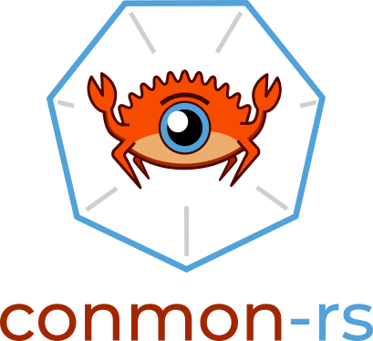

<p align="center"></p>

[](https://github.com/containers/conmon-rs/actions/workflows/ci.yml)
[](https://github.com/containers/conmon-rs/actions/workflows/gh-pages.yml)
[](https://codecov.io/gh/containers/conmon-rs)
[](https://deps.rs/repo/github/containers/conmon-rs)
[](https://copr.fedorainfracloud.org/coprs/rhcontainerbot/podman-next/package/conmon-rs)
[](https://containers.github.io/conmon-rs/conmonrs/index.html)
[](https://pkg.go.dev/github.com/containers/conmon-rs/pkg/client)

A pod level OCI container runtime monitor for Linux.

conmon-rs does what [conmon](https://github.com/containers/conmon) does for a
single container, for a whole pod: a container engine like
[CRI-O](https://github.com/cri-o/cri-o) starts one `conmonrs` process per pod,
and that process creates the containers of the pod through the OCI runtime,
holds their standard streams open, forwards their output to log files or
journald, serves attach, exec and port forward sessions, detects out of memory
kills and writes the exit codes once the containers terminate. The engine
talks to it over a UNIX domain socket, so no new monitor process is needed for
additional containers or execs. It works with cgroup v1 and v2 and any OCI
runtime with the `create`, `exec`, `restore` and console socket conventions of
runc, like crun. CI runs the integration tests with crun, and on amd64 with runc
as well, on cgroup v2 only.

## Documentation

- [docs/install.md](docs/install.md): the options of the get script, verifying
  the downloads, the copr RPMs and building from source.
- [docs/architecture.md](docs/architecture.md): the components, the operations
  of the server, its threading and memory use, and how the pieces connect.
- [docs/cri-o.md](docs/cri-o.md): configuring CRI-O, the compatibility between
  CRI-O and server versions, upgrades and the use on Red Hat OpenShift.
- [docs/server.md](docs/server.md): the command line of the server, what it
  does when it starts and stops.
- [docs/protocols.md](docs/protocols.md): the Cap'n Proto RPC, the attach
  socket, the streaming server for exec, attach and port forwarding with its
  limits and security, and the features a server reports.
- [docs/logging.md](docs/logging.md): the container log drivers and how the
  server reports OOM kills.
- [docs/troubleshooting.md](docs/troubleshooting.md): finding the logs of the
  server, common failures, debugging the server of a pod under CRI-O, memory
  profiling and OpenTelemetry tracing.
- [CONTRIBUTING.md](CONTRIBUTING.md): building, testing and fuzzing the
  sources, and submitting changes.
- [release.md](release.md): how to cut a release.
- [SECURITY.md](SECURITY.md): how to report a security issue.
- [Rust docs](https://containers.github.io/conmon-rs/conmonrs/index.html) of
  the server internals on `main` and the [Go client
  docs](https://pkg.go.dev/github.com/containers/conmon-rs/pkg/client).

## Obtain the latest version

The [get script](scripts/get) downloads the latest statically linked binary of
`main`:

```console
> curl -fsSL https://raw.githubusercontent.com/containers/conmon-rs/main/scripts/get | bash
```

[docs/install.md](docs/install.md) describes the options of the script, the
copr RPMs and how to build from source.

## Architecture

The repository contains the Rust server in [conmon-rs/server](conmon-rs/server),
the `conmonrs` binary, and the Go client in [pkg/client](pkg/client), which
starts the server and talks to it over Cap'n Proto RPC. CRI-O vendors this
client. [docs/architecture.md](docs/architecture.md) describes how they work
together.
