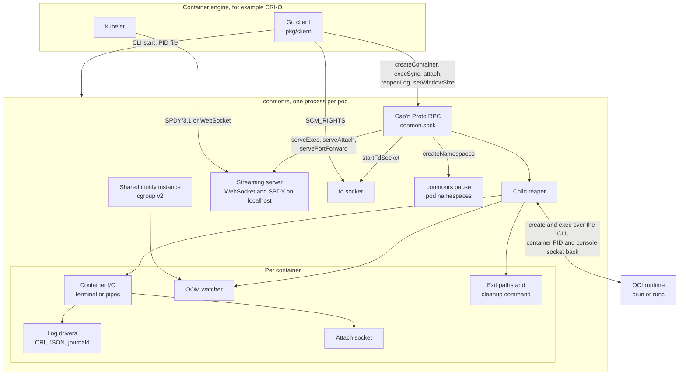

<p align="center"></p>

[](https://github.com/containers/conmon-rs/actions/workflows/ci.yml)
[](https://github.com/containers/conmon-rs/actions/workflows/gh-pages.yml)
[](https://codecov.io/gh/containers/conmon-rs)
[](https://deps.rs/repo/github/containers/conmon-rs)
[](https://copr.fedorainfracloud.org/coprs/rhcontainerbot/podman-next/package/conmon-rs)
[](https://containers.github.io/conmon-rs/conmonrs/index.html)
[](https://pkg.go.dev/github.com/containers/conmon-rs/pkg/client)

A pod level OCI container runtime monitor for Linux.

conmon-rs does what [conmon](https://github.com/containers/conmon) does for a
single container, for a whole pod: a container engine like
[CRI-O](https://github.com/cri-o/cri-o) starts one `conmonrs` process per pod,
and that process creates the containers of the pod through the OCI runtime,
holds their standard streams open, forwards their output to log files or
journald, serves attach, exec and port forward sessions, detects out of memory
kills and writes the exit codes once the containers terminate. The engine
talks to it over a UNIX domain socket, so no new monitor process is needed for
additional containers or execs. It works with cgroup v1 and v2 and any OCI
runtime with the `create`, `exec` and console socket conventions of runc, like
crun. CI runs the integration tests on cgroup v2 only.

## Documentation

- [usage.md](usage.md): configuring CRI-O, the compatibility between CRI-O
  and server versions, upgrades, the command line, the `pause` subcommand, the
  protocols between the server and its clients, the features, logging,
  troubleshooting, tracing and the use on Red Hat OpenShift.
- [release.md](release.md): how to cut a release.
- [SECURITY.md](SECURITY.md): how to report a security issue.
- [Rust docs](https://containers.github.io/conmon-rs/conmonrs/index.html) of
  the server internals on `main` and the [Go client
  docs](https://pkg.go.dev/github.com/containers/conmon-rs/pkg/client).

## Obtain the latest version

We provide statically linked binaries for every successfully built commit on
`main` via our [Google Cloud Storage Bucket][bucket], for `amd64`, `arm64`,
`ppc64le` and `s390x`. Our provided [get script](scripts/get) can be used to
download the latest version:

```console
> curl -fsSL https://raw.githubusercontent.com/containers/conmon-rs/main/scripts/get | bash
```

It is also possible to select a specific commit by its full 40 character SHA
(`-t`), a release tag like `vX.Y.Z` (`-l`), the architecture (`-a`, defaults to
the local one) or the output binary path (`-o`), and to skip running the
installed binary for its version (`-n`). With `-l`, the script resolves the tag
through the GitHub API, which needs [`jq`](https://jqlang.org):

```console
> curl -fsSL https://raw.githubusercontent.com/containers/conmon-rs/main/scripts/get | \
    bash -s -- -l vX.Y.Z -a arm64 -o $OUTPUT_PATH -n
```

The script verifies the sigstore signature of the binary if the local system
has [`cosign`](https://github.com/sigstore/cosign) available in its `$PATH`.
The signature has to come from the ci workflow run of exactly that commit on
`main`. Without cosign, the script only checks the SHA-256 checksum, the one of
`sha256sums.txt` for a release and the one in the bucket otherwise, which only
shows that the download is complete. It fails if no checksum got published,
like for old commits and the releases before v1.1.0, unless `-k` is given.

Without `-t` and `-l`, the script checks with the GitHub API that the latest
commit of the bucket is on `main`, and warns if it is more than a day older than
the head of `main`, like when the bucket points back to an old commit. Without
`jq`, or if the API fails, like because of its rate limit (`GITHUB_TOKEN` raises
it), the script only warns.

Every commit on `main` is also built as an RPM in the [podman-next
copr](https://copr.fedorainfracloud.org/coprs/rhcontainerbot/podman-next/package/conmon-rs).

[bucket]: https://console.cloud.google.com/storage/browser/cri-o/conmon-rs

## Verify the downloads

The bucket serves the files of a commit at
`https://storage.googleapis.com/cri-o/conmon-rs/$COMMIT/`, `latest-main.txt`
names the latest commit of `main` whose binaries got published and whose tests
passed, and `latest-X.Y.txt` the latest release tag of a minor version. Since
v1.1.0, the [GitHub releases](https://github.com/containers/conmon-rs/releases)
carry the same binaries as `conmonrs.$ARCH` with their signatures, built from
the commit of the tag. To verify a binary by hand, download it with its files and set
`COMMIT` to that commit (the assignments `COMMIT=$(...)` need a POSIX shell
like bash or zsh), either for a release:

```console
> gh release download vX.Y.Z --repo containers/conmon-rs \
    --pattern 'conmonrs.amd64*'
> COMMIT=$(gh api repos/containers/conmon-rs/commits/vX.Y.Z --jq .sha)
```

or for the latest commit of `main` in the bucket:

```console
> COMMIT=$(curl -fsSL https://storage.googleapis.com/cri-o/conmon-rs/latest-main.txt)
> curl -fsSL --remote-name-all \
    "https://storage.googleapis.com/cri-o/conmon-rs/$COMMIT/conmonrs.amd64{,.bundle,.intoto.jsonl,.spdx.json,.spdx.intoto.jsonl,.vex.json,.vex.intoto.jsonl}"
```

curl expands the braces itself. For an older commit, it reports a 404 for
each of these files the commit does not have and exits with an error, but
still downloads the others. Then check the signature, which the publish-static
workflow made (use `ci.yml` instead of `publish-static.yml` for older commits
without attestations, like the ones of v1.1.0 and v1.1.1):

```console
> cosign verify-blob conmonrs.amd64 \
    --bundle conmonrs.amd64.bundle \
    --certificate-identity https://github.com/containers/conmon-rs/.github/workflows/publish-static.yml@refs/heads/main \
    --certificate-oidc-issuer https://token.actions.githubusercontent.com \
    --certificate-github-workflow-sha "$COMMIT"
```

The binaries of newer commits on `main`, and of the releases since v1.2.0,
also come with [SLSA](https://slsa.dev) Build L3 provenance and an SPDX 2.3
SBOM, both as GitHub artifact attestations. A job without access to the
signing credentials builds them, the reusable [publish-static
workflow](.github/workflows/publish-static.yml), which runs no build steps,
attests and signs them. Verify them with the [GitHub
CLI](https://cli.github.com), which also checks that they got built from
`$COMMIT`:

```console
> gh attestation verify conmonrs.amd64 \
    --repo containers/conmon-rs \
    --signer-workflow containers/conmon-rs/.github/workflows/publish-static.yml \
    --source-ref refs/heads/main \
    --source-digest "$COMMIT"
```

Add `--predicate-type https://spdx.dev/Document/v2.3` for the SBOM. The
binaries of newer commits, and of the releases since v1.2.1, also come with an
[OpenVEX](https://openvex.dev) document as an attestation, which states how
known vulnerabilities of the crates of the SBOM affect conmon-rs. It is the
document [vex/conmonrs.openvex.json](vex/conmonrs.openvex.json) of the commit,
release.md describes its statements. Verify it and print the attested
document with:

```console
> gh attestation verify conmonrs.amd64 \
    --repo containers/conmon-rs \
    --signer-workflow containers/conmon-rs/.github/workflows/publish-static.yml \
    --source-ref refs/heads/main \
    --source-digest "$COMMIT" \
    --predicate-type https://openvex.dev/ns/v0.2.0 \
    --format json --jq '.[0].verificationResult.statement.predicate'
```

The bucket and the releases carry the attestation bundles as well
(`conmonrs.$ARCH.intoto.jsonl`, `conmonrs.$ARCH.spdx.intoto.jsonl` and
`conmonrs.$ARCH.vex.intoto.jsonl`), and the SBOM and the VEX document
themselves (`conmonrs.$ARCH.spdx.json` and `conmonrs.$ARCH.vex.json`).
`gh attestation verify` takes a bundle with `--bundle` and the matching
`--predicate-type` instead of fetching the attestations from GitHub.

### Scan with the VEX document

The statements of the VEX document name conmon-rs
(`pkg:github/containers/conmon-rs`) as their product and the affected crates
as its subcomponents. Neither [grype](https://github.com/anchore/grype) nor
[trivy](https://trivy.dev) applies such a statement to the SBOM of the binary:
grype only matches a statement whose product is the vulnerable crate itself,
trivy does not know the `pkg:github` type, and both ignore the statements
silently. Make the subcomponents the products first, which both apply:

```console
> jq '.statements |= map(.products = [.products[].subcomponents[]])' \
    conmonrs.amd64.vex.json >crates.vex.json
> grype sbom:conmonrs.amd64.spdx.json --vex crates.vex.json
> trivy sbom conmonrs.amd64.spdx.json --vex crates.vex.json
```

`make scan SBOMS=conmonrs.amd64.spdx.json` does the same with grype and the
VEX document of the repository.

### Verify the source tarball

Since v1.2.0, the source tarball and the `sha256sums.txt` of a release have
SLSA Build L3 provenance (also as the bundle `sources.intoto.jsonl`) and cosign
signatures (`conmonrs-vX.Y.Z.tar.gz.bundle` and `sha256sums.txt.bundle`) of
the reusable [build-sources workflow](.github/workflows/build-sources.yml) for
the tag. `sha256sums.txt` lists the checksums of the tarball and the binaries.
`COMMIT` is the commit of the tag, like for the binaries of a release:

```console
> gh release download vX.Y.Z --repo containers/conmon-rs \
    --pattern conmonrs-vX.Y.Z.tar.gz --pattern 'sha256sums.txt*' \
    --pattern sources.intoto.jsonl
> COMMIT=$(gh api repos/containers/conmon-rs/commits/vX.Y.Z --jq .sha)
> gh attestation verify conmonrs-vX.Y.Z.tar.gz \
    --bundle sources.intoto.jsonl \
    --repo containers/conmon-rs \
    --signer-workflow containers/conmon-rs/.github/workflows/build-sources.yml \
    --source-ref refs/tags/vX.Y.Z \
    --source-digest "$COMMIT"
> cosign verify-blob sha256sums.txt \
    --bundle sha256sums.txt.bundle \
    --certificate-identity https://github.com/containers/conmon-rs/.github/workflows/build-sources.yml@refs/tags/vX.Y.Z \
    --certificate-oidc-issuer https://token.actions.githubusercontent.com \
    --certificate-github-workflow-sha "$COMMIT"
> sha256sum --ignore-missing -c sha256sums.txt
```

## Architecture

The repository contains two components:

1. The Rust server in [conmon-rs/server](./conmon-rs/server), the `conmonrs`
   binary. Its Cap'n Proto interface lives in
   [conmon-rs/server/proto/conmon.capnp](./conmon-rs/server/proto/conmon.capnp).
2. The Go client in [pkg/client](./pkg/client), which starts the server, talks
   to it over Cap'n Proto RPC and hides the RPC types behind plain Go
   structures. CRI-O vendors this client.

The server is started once per pod by the client, forks into the background and
listens on a UNIX domain socket for RPCs. The client runs the following
operations against it:

- **Create container**: the server runs the OCI runtime's `create`, keeps the
  container's standard streams (pipes or a pseudo terminal received over the
  runtime's console socket), writes the output to the configured log drivers
  (CRI format, JSON or journald) and watches the container's cgroup for out of
  memory events. When the container exits, the exit code is written to the exit
  paths and an optional cleanup command is run. With `sdnotifySocket` set, the
  server also relays the sd_notify messages of the container from
  `<bundle>/notify/notify.sock` to that host socket, like conmon does with
  `--sdnotify-socket`.
- **Exec**: `execSyncContainer` runs a command inside a container and returns
  its output and exit code. For interactive execs and attaches
  (`serveExecContainer`, `serveAttachContainer`), the server opens a streaming
  server on localhost which speaks the Kubernetes remote command protocols over
  WebSocket and SPDY, so CRI-O can hand the URL straight to the kubelet. The
  same server forwards ports into the pod network namespace over SPDY or
  WebSocket (`servePortForwardContainer`).
- **Attach**: `attachContainer` serves output and stdin of a container on a per
  container attach socket, the protocol conmon speaks as well.
- **Namespaces**: `createNamespaces` creates the pod level namespaces and bind
  mounts them, using the `conmonrs pause` subcommand to hold a PID namespace
  open. CRI-O does not use it and keeps pinning the namespaces with `pinns`,
  other clients can use it instead of `pinns`.
- **File descriptors**: `startFdSocket` opens a socket on which a client passes
  file descriptors to the server, for example to leak into or hand over to a
  container.
- **Maintenance**: `reopenLogContainer` starts new log files at the paths of
  a container after the caller rotated them (the journald driver is not
  affected), `setWindowSizeContainer` resizes its terminal, `version` reports
  the server build and its features.

The server is single threaded: a tokio `current_thread` runtime drives all I/O
and runs the Cap'n Proto RPC on the same thread, and blocking work like file
I/O goes to a small bounded pool. With cgroup v2, all containers of a pod
share one inotify instance for OOM detection, with cgroup v1 every container
gets an eventfd on its `memory.oom_control`. The read loops of all containers
share one scratch buffer of the runtime thread, 8 KiB, or 64 KiB once an
attach client sent stdin, so an idle container holds no read buffer. Per
container, the server keeps an 8 KiB buffer per log
file once the container wrote output, the channels for exec output and a few
tasks. With glibc, the server limits malloc to a single arena instead of one
per thread. That is why a pod with many containers still fits in a few
megabytes.

The following diagram shows how the pieces connect:



## Development

Building the server needs the Cap'n Proto compiler (`capnp`, packaged as
`capnproto`) and a Rust toolchain of at least the `rust-version` of
[Cargo.toml](./Cargo.toml). The tests of the Go client and the integration
suite need the Go version of [go.mod](./go.mod). The integration suite is a
module of its own in [pkg/client/integration](./pkg/client/integration), so
that its dependencies do not become requirements of the client. The
dependencies of the client follow CRI-O main, the modules only the suite needs
follow the latest releases. To build and install a release binary:

```console
> make release
> sudo make install PREFIX=/usr/local
```

Packages built from a source tarball, which has no git metadata, pass in what
`--version` shows: `BUILD_TAG=vX.Y.Z` or `BUILD_COMMIT=<sha>`, either one wins
over git and leaves the other one empty, and `SOURCE_DATE_EPOCH` for the build
date, which is the time of the build otherwise. The dependency tree of
`--version full` comes from `cargo tree --locked --offline` during the build,
which needs the crates of [Cargo.lock](./Cargo.lock) present, like after
`cargo fetch` or `cargo vendor`, the tree stays empty otherwise.
`CONMONRS_SKIP_CARGO_TREE` leaves it empty and skips that step. See
[conmon-rs/server/build.rs](./conmon-rs/server/build.rs), and
[rpm/conmon-rs.spec](./rpm/conmon-rs.spec) for how the RPM passes them.

The [Makefile](./Makefile) has targets for most of what CI runs: `make` builds
the server, `make lint` runs rustfmt, clippy, rustdoc, golangci-lint and
shellcheck (which has to be installed), `make lint-msrv` checks the sources
with the `rust-version` toolchain of rustup, `make unit` runs the Rust unit
tests, `make unit-go` the ones of the Go client and `make integration` runs
the Go integration suite against the release binary (`RUNTIME_PATH` selects
the OCI runtime, the suite needs root for the namespace and OOM specs). `make
verify` runs the remaining checks, like prettier, cargo-deny, typos (both have
to be installed), actionlint and zizmor, some of them in containers. `make
help` lists the rest. Contributions follow [CONTRIBUTING.md](./CONTRIBUTING.md).

The [fuzz](./fuzz) directory holds [cargo-fuzz](https://github.com/rust-fuzz/cargo-fuzz)
targets for what clients and containers send: the streaming protocols (SPDY
frames, header blocks and connections, WebSocket messages, resize events,
upgrade headers and port forward queries, the setup of exec, attach and port
forward sessions and their pending stdin), the container output as log lines,
the notify messages and the process stat files with their command names, and
for the journal entries the server writes.
`cargo fuzz list` lists them, each file in
[fuzz/fuzz_targets](./fuzz/fuzz_targets) tells what its target covers. They
need a nightly toolchain, for example `cargo +nightly fuzz run spdy_frames`, CI
pins the one of `FUZZ_TOOLCHAIN` in
[ci.yml](.github/workflows/ci.yml). [fuzz/seeds](./fuzz/seeds) holds a few
valid inputs per target to start from, pass the directory after the corpus,
which libFuzzer does not create:

```console
> mkdir -p fuzz/corpus/spdy_frames
> cargo +nightly fuzz run spdy_frames fuzz/corpus/spdy_frames fuzz/seeds/spdy_frames
```

cargo-fuzz builds with the release profile of the server, which strips the
symbols and builds slowly. CI overrides it with
`CARGO_PROFILE_RELEASE_STRIP=false CARGO_PROFILE_RELEASE_DEBUG=line-tables-only
CARGO_PROFILE_RELEASE_LTO=false CARGO_PROFILE_RELEASE_OPT_LEVEL=3
CARGO_PROFILE_RELEASE_CODEGEN_UNITS=16`, which helps local runs as well.
