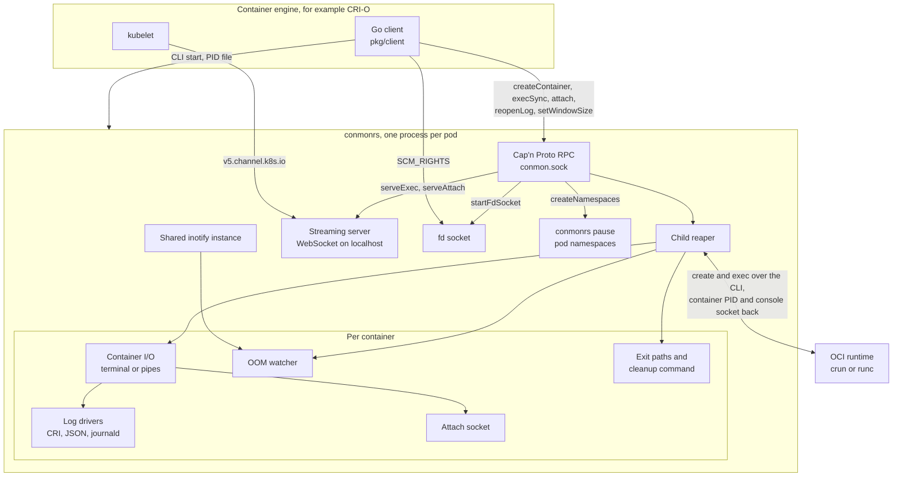

<p align="center"></p>

[](https://github.com/containers/conmon-rs/actions)
[](https://github.com/containers/conmon-rs/actions)
[](https://codecov.io/gh/containers/conmon-rs)
[](https://deps.rs/repo/github/containers/conmon-rs)
[](https://copr.fedorainfracloud.org/coprs/rhcontainerbot/podman-next/package/conmon-rs)
[](https://containers.github.io/conmon-rs/conmonrs/index.html)
[](https://pkg.go.dev/github.com/containers/conmon-rs/pkg/client)

A pod level OCI container runtime monitor for Linux.

conmon-rs does what [conmon](https://github.com/containers/conmon) does for a
single container, for a whole pod: a container engine like
[CRI-O](https://github.com/cri-o/cri-o) starts one `conmonrs` process per pod,
and that process creates the containers of the pod through the OCI runtime,
holds their standard streams open, forwards their output to log files or
journald, serves attach and exec sessions, detects out of memory kills and
writes the exit codes once the containers terminate. The engine talks to it over
a UNIX domain socket, so no new monitor process is needed for additional
containers or execs. It works with cgroup v1 and v2 and any OCI runtime with
the `create`, `exec` and console socket conventions of runc, like crun.

## Documentation

- [usage.md](usage.md): configuring CRI-O, the command line, the `pause`
  subcommand and the protocols between the server and its clients.
- [release.md](release.md): how to cut a release.
- [Rust API docs](https://containers.github.io/conmon-rs/conmonrs/index.html)
  and [Go client docs](https://pkg.go.dev/github.com/containers/conmon-rs/pkg/client).

## Obtain the latest version

We provide statically linked binaries for every successfully built commit on
`main` via our [Google Cloud Storage Bucket][bucket]. Our provided [get
script](scripts/get) can be used to download the latest version:

```console
> curl https://raw.githubusercontent.com/containers/conmon-rs/main/scripts/get | bash
```

It is also possible to select a specific git SHA or the output binary path by:

```console
> curl https://raw.githubusercontent.com/containers/conmon-rs/main/scripts/get | \
    bash -s -- -t $GIT_SHA -o $OUTPUT_PATH
```

The script automatically verifies the created sigstore signatures if the local
system has [`cosign`](https://github.com/sigstore/cosign) available in its
`$PATH`.

Every commit on `main` is also built as an RPM in the [podman-next
copr](https://copr.fedorainfracloud.org/coprs/rhcontainerbot/podman-next/package/conmon-rs).

[bucket]: https://console.cloud.google.com/storage/browser/cri-o/conmon-rs

## Architecture

The repository contains two components:

1. The Rust server in [conmon-rs/server](./conmon-rs/server), the `conmonrs`
   binary. Its Cap'n Proto interface lives in
   [conmon-rs/common/proto/conmon.capnp](./conmon-rs/common/proto/conmon.capnp).
2. The Go client in [pkg/client](./pkg/client), which starts the server, talks
   to it over Cap'n Proto RPC and hides the RPC types behind plain Go
   structures. CRI-O vendors this client.

The server is started once per pod by the client, forks into the background and
listens on a UNIX domain socket for RPCs. The client runs the following
operations against it:

- **Create container**: the server runs the OCI runtime's `create`, keeps the
  container's standard streams (pipes or a pseudo terminal received over the
  runtime's console socket), writes the output to the configured log drivers
  (CRI format, JSON or journald) and watches the container's cgroup for out of
  memory events. When the container exits, the exit code is written to the exit
  paths and an optional cleanup command is run.
- **Exec**: `execSyncContainer` runs a command inside a container and returns
  its output and exit code. For interactive execs and attaches
  (`serveExecContainer`, `serveAttachContainer`), the server opens a WebSocket
  streaming server on localhost which speaks the Kubernetes `v5.channel.k8s.io`
  protocol, so CRI-O can hand the URL straight to the kubelet.
- **Attach**: `attachContainer` serves output and stdin of a container on a per
  container attach socket, the protocol conmon speaks as well.
- **Namespaces**: `createNamespaces` creates the pod level namespaces and bind
  mounts them, using the `conmonrs pause` subcommand to hold a PID namespace
  open. This replaces what CRI-O otherwise does with `pinns`.
- **File descriptors**: `startFdSocket` opens a socket on which a client passes
  file descriptors to the server, for example to leak into or hand over to a
  container.
- **Maintenance**: `reopenLogContainer` rotates the log files of a container,
  `setWindowSizeContainer` resizes its terminal, `version` reports the server
  build.

The server is single threaded: a tokio `current_thread` runtime drives all I/O,
the Cap'n Proto RPC runs on one additional thread, and blocking work like file
I/O goes to a small bounded pool. All containers of a pod share one inotify
instance for OOM detection. Per container, the server keeps two 4 KiB read
buffers, the channels for exec output and a few tasks, which is why a pod with
many containers still fits in a few megabytes.

The following diagram shows how the pieces connect:



## Development

The [Makefile](./Makefile) has targets for everything CI runs: `make` builds the
server, `make lint` runs clippy and golangci-lint, `make unit` runs the Rust
unit tests and `make integration` runs the Go integration suite against the
release binary (`RUNTIME_PATH` selects the OCI runtime, the suite needs root for
the namespace and OOM specs). `make help` lists the rest. Contributions follow
[CONTRIBUTING.md](./CONTRIBUTING.md).
