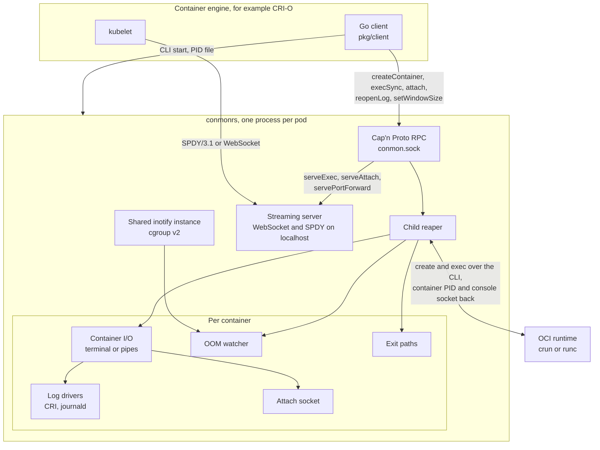

# Architecture

The repository contains two components:

1. The Rust server in [conmon-rs/server](../conmon-rs/server), the `conmonrs`
   binary. Its Cap'n Proto interface lives in
   [conmon-rs/server/proto/conmon.capnp](../conmon-rs/server/proto/conmon.capnp).
2. The Go client in [pkg/client](../pkg/client), which starts the server, talks
   to it over Cap'n Proto RPC and hides the RPC types behind plain Go
   structures. CRI-O vendors this client.

The server is started once per pod by the client, forks into the background and
listens on a UNIX domain socket for RPCs. The client runs the following
operations against it:

- **Create container**: the server runs the OCI runtime's `create`, or its
  `restore` for a request with a checkpoint to restore from, keeps the
  container's standard streams (pipes or a pseudo terminal received over the
  runtime's console socket), writes the output to the configured log drivers
  (CRI format or journald) and watches the container's cgroup for out of
  memory events. When the container exits, the exit code is written to the exit
  paths.
- **Exec**: `execSyncContainer` runs a command inside a container and returns
  its output and exit code. For interactive execs and attaches
  (`serveExecContainer`, `serveAttachContainer`), the server opens a streaming
  server on localhost which speaks the Kubernetes remote command protocols over
  WebSocket and SPDY, so CRI-O can hand the URL straight to the kubelet. The
  same server forwards ports into the pod network namespace over SPDY or
  WebSocket (`servePortForwardContainer`). The server passes exec commands to
  the runtime after `--`, so that a runtime cannot take a command whose first
  element starts with `-` for its own options, see the
  [changes of the protocols](protocols.md#changes).
- **Attach**: `attachContainer` serves output and stdin of a container on a per
  container attach socket, the protocol conmon speaks as well.
- **Maintenance**: `reopenLogContainer` starts new log files at the paths of
  a container after the caller rotated them (the journald driver is not
  affected), `setWindowSizeContainer` resizes its terminal for the resize
  events of an attach, `version` reports the server build and its features.

The server is single threaded: a tokio `current_thread` runtime drives all I/O
and runs the Cap'n Proto RPC on the same thread, and blocking work like file I/O
goes to a small bounded pool. All containers of a pod share one inotify instance
for OOM detection with cgroup v2. The read loops of all containers and the
readers of runtime output share one scratch buffer of the runtime thread, 8 KiB,
or 33 KiB once an attach client sent stdin, so an idle container holds no read
buffer. Per container, the server keeps the channels for exec output and a few
tasks; a log file holds its buffer only while it writes a chunk of output. With
glibc, the server limits malloc to a single arena instead of one per thread.
That is why a pod with many containers still fits in a few megabytes: an idle
server has about 0.5 MiB of memory of its own besides the pages of its binary,
see [Debugging a pod](troubleshooting.md#debugging-a-pod) for the numbers and
the budget CI enforces.

The following diagram shows how the pieces connect:

